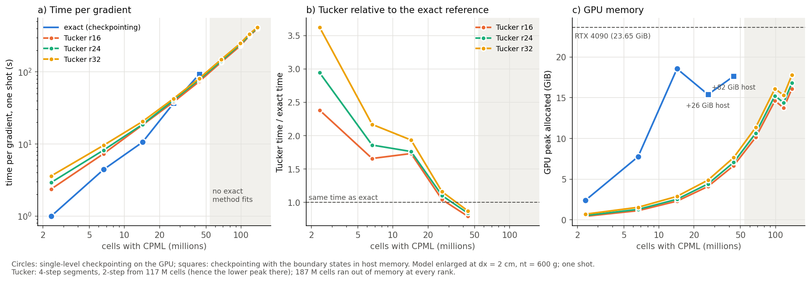

# Tucker model parameterization and streaming Tucker sketching of the adjoint history

DeepGPR provides two independent, optional Tucker modules:

| | Module A: model parameterization | Module B: wavefield-history sketch |
|---|---|---|
| What is low-rank | the material model `eps_r`, `sigma` | the forward history `E^n`, `R^n` read by the adjoint |
| Code | `DeepGPR.tucker.model` | `DeepGPR.tucker.sketch`, `DeepGPR.tucker.wavefield`, `DeepGPR.solver.sketched` |
| Switch | build the model with `TuckerMaterialModel` / `tucker_reconstruct`, or not | `DeepGPR.compute(..., wavefield_sketch=TuckerSketchConfig(...))` |
| Affects | the optimisation variables | memory of the gradient computation; the gradient becomes approximate |
| Default | off (plain tensors) | off (`wavefield_sketch=None`) |

The modules share only stateless helpers (`DeepGPR/tucker/_tensor_ops.py`: mode
products, unfoldings, error metrics). They never share cores, factors, random
maps or optimizer state, and either works without the other.

| Model Tucker | History sketch | Mode |
|---|---|---|
| off | off | original DeepGPR (bitwise identical results, Test C) |
| on | off | low-rank model parameterization, exact discrete adjoint |
| off | on | voxel model, approximate gradient from the compressed history |
| on | on | both |

Implicit neural representations (SIREN, Fourier features, MLPs) are **not**
part of DeepGPR. DeepGPR provides the differentiable reconstruction that an
external network can feed (Section 2.3).

Contents: 1 Mathematics of Module A, 2 Module A API, 3 Mathematics of Module B,
4 Module B integration and data flow, 5 Module B API, 6 Checkpointing,
7 Error sources, 8 Tests, 9 Benchmarks, 10 Limitations and open items.

---

## 1. Module A: Tucker parameterization of the material model

A 3D model `M ∈ R^{Nx×Ny×Nz}` is represented as

```
M = G ×_1 U_x ×_2 U_y ×_3 U_z,   G ∈ R^{rx×ry×rz},  U_x ∈ R^{Nx×rx}, U_y ∈ R^{Ny×ry}, U_z ∈ R^{Nz×rz}
```

(`×_n` is the mode-n product), and a 2D model as `M = U_x G U_y^T`. Any ranks
`1 <= r_n <= N_n` are allowed and need not be equal.

**Reconstruction.** `tucker_reconstruct(core, factors)` applies the mode
products as a chain of `torch.tensordot` calls, ordered by increasing growth
`N_n / r_n` (cost `O(prod(N) r_last)` for the last product). There is no
`detach`, `.data` or in-place write, so autograd differentiates the result with
respect to the core, every factor, and whatever computed them. The gradients
are the adjoint mode products

```
dL/dG   = dL/dM ×_1 U_x^T ×_2 U_y^T ×_3 U_z^T
dL/dU_x = (dL/dM)_(1) (G ×_2 U_y ×_3 U_z)_(1)^T     (and similarly for U_y, U_z)
```

which Test A checks against autograd (1e-13) and Test C checks through the
FDTD adjoint (the core gradient equals `tucker_project(dL/dM, factors)` to
float32 rounding).

**Gradient path through the solver.** `DeepGPR.compute` casts the material to
float32, extends it into the CPML (`_ExtendModel`, whose transpose sums the
replicated PML sensitivities back onto the model edges) and passes it to the
native solver through `DeepGPR.solver.autograd.DeepGPR`, a
`torch.autograd.Function` whose backward runs the native exact discrete
adjoint and returns `dL/d eps_r` and `dL/d sigma` on the extended grid. Every
step before the native call is an ordinary differentiable PyTorch operation, so
a non-leaf `eps_r` (a Tucker reconstruction or a network output) receives its
gradient by the chain rule. No change to the native code or to the autograd
Function was needed for Module A. A float64 Tucker model is accepted; the
solver runs in float32 and the gradient is cast back to float64 by autograd.

**Scale gauge.** For any invertible `A_n`, `(G ×_n A_n^{-1}, U_n A_n)`
represents the same tensor. With raw factors the optimizer can drift along
this flat valley, and Adam's per-entry steps treat core entries of size
`O(||M||)` and factor entries of size `O(1/sqrt(N_n))` very differently.
`TuckerTensor(factor_normalization=...)` fixes the gauge inside the forward
pass:

* `"rms"` (default): `U_n = V_n sqrt(N_n) / ||V_n||_col` (weight
  normalization of each column). Column scalings of the raw `V_n` do not change
  `M`; the core carries the physical scale (a constant model `c` has core
  `c`); factor entries are `O(1)`.
* `"orthonormal"`: `U_n = qr(V_n).Q` with a sign fix.
* `"none"`: raw factors, with `orthogonalize_()` (re-gauge in place to
  orthogonal unit-RMS factors, model unchanged) and `gauge_penalty()`
  (`sum_n ||U_n^T U_n / N_n - I||^2`) as tools.

Measured on a rank-(4,4,4) fit of a 60×60×50 tensor (constant background plus
a rank-3 anomaly, 500 Adam iterations, relative loss reduction): `"rms"`
reaches 1e-10..1e-11 for every learning rate in 0.003..0.03; raw factors are
slower at 0.003 (2e-4..2e-3) and stall at 0.1 (0.25); QR-orthonormal factors
converge slowly with Adam (0.42 at lr 0.03). The default is therefore `"rms"`.
Test A keeps a reduced version of this check.

**Learning rate.** Adam moves every trainable entry by about `lr` per step,
and each factor entry influences a whole fibre of the model, so the model-space
step of a Tucker parameterization is much larger than that of a voxel model at
the same `lr`. In the reduced FWI examples of Test C, voxel Adam converged with
`lr = 0.02..0.05`, the Tucker models diverged at `lr >= 0.005` (2D) and
converged with `lr = 0.001..0.002`. L-BFGS with a Wolfe line search (used in
the benchmarks) needs no learning rate.

**Bounds.** `MaterialMapping` maps the unconstrained Tucker value `T` to a
material value differentiably: `"identity"` (`offset + scale T`), `"sigmoid"`
(`lower + (upper - lower) sigmoid(T)`), `"softplus"` (`lower + scale
softplus(T)`), `"exp"` (`lower + scale exp(T)`). Hard clipping is not offered
(zero gradient). Bounds matter in practice: a low-rank approximation of a model
with an air layer (`eps_r = 1`) undershoots below 1, which `compute` rejects;
`mapping="softplus", bounds=(1.0, None)` avoids it (Test C).

**Initialisation.** `TuckerModelConfig(init=...)`: `"hosvd"` (truncated HOSVD
of `mapping.inverse(initial model)`), `"randomized"` (Gaussian range finder per
unfolding, Halko-Martinsson-Tropp, then truncation), `"random"` (orthonormal
random factors, Gaussian core). `TuckerMaterialField.from_factors(core,
factors)` starts from user tensors. The decomposition is used once, for
initialisation; during the inversion the core and factors are the optimisation
variables (no per-iteration re-decomposition or sketching of the model).

**Parameter accounting.** `tucker_parameter_count(shape, ranks)` returns the
dense-grid count (the comparison basis), the core count `prod(r)`, the factor
count `sum(N_n r_n)`, the total and the ratio. For 120×120×100: ranks 8 →
3 264 values (441×), 12 → 5 808 (248×), 16 → 9 536 (151×), 24 → 21 120 (68×).
`TuckerTensor.memory_report()` gives measured bytes of parameters and
gradients and of the reconstructed grid. The reconstructed full model is still
materialised on every forward pass (the FDTD solver needs it), so Tucker
reduces the trainable state (parameters, gradients, optimizer moments) and
regularises the model; it does not reduce the solver's memory. If an external
network produces the factors, its own trainable parameters replace the factor
count in a fair comparison; DeepGPR cannot count them.

## 2. Module A API

```python
import DeepGPR
from DeepGPR.tucker import (TuckerModelConfig, TuckerMaterialModel, TuckerTensor,
                            tucker_reconstruct, tucker_parameter_count)

model = TuckerMaterialModel.from_models(
    eps_init, sigma_init,
    TuckerModelConfig(ranks=(12, 12, 12), mapping="softplus", bounds=(1.0, None)),
    TuckerModelConfig(ranks=(6, 8, 8), mapping="softplus", bounds=(0.0, None), scale=1e-3),
)
optimizer = torch.optim.Adam(model.parameter_groups(epsilon_lr=1e-3, sigma_lr=1e-3))
eps_r, sigma = model()                     # full tensors, differentiable
data = DeepGPR.compute(..., eps_r=eps_r, sigma=sigma, mode=3)[-1]
loss = ((data - observed) ** 2).sum()
loss.backward()                            # gradients reach the Tucker cores/factors
optimizer.step()
```

| Object | Purpose |
|---|---|
| `tucker_reconstruct(core, factors)` | pure differentiable reconstruction; `None` factor = identity |
| `tucker_project(tensor, factors)` | adjoint `tensor ×_n U_n^T` |
| `hosvd`, `randomized_hosvd` | one-off decompositions for initialisation |
| `TuckerTensor(core, factors, factor_normalization="rms", trainable=True)` | trainable container; `from_tensor`, `random`, `export`/`from_export`, `state_dict`, `.to()`, `orthogonalize_`, `gauge_penalty`, `parameter_count`, `memory_report` |
| `MaterialMapping(kind, lower, upper, scale, offset)` | differentiable bound map with `inverse` |
| `TuckerModelConfig` | per-field options: `enabled`, `ranks`, `init`, `mapping`, `bounds`, `scale`, `offset`, `factor_normalization`, `trainable`, `oversampling`, `seed`, `random_scale` |
| `TuckerMaterialField` / `DenseMaterialField` | one field, Tucker or voxel, with a mapping |
| `TuckerMaterialModel.from_models(eps, sigma, eps_config, sigma_config)` | independent fields; `forward() -> (eps_r, sigma)`, `parameter_groups`, `parameter_report` |

`enabled=False` gives a dense voxel field (optionally with the same mapping);
`trainable=False` a fixed one. Using plain tensors for `eps_r`/`sigma`
bypasses all of this.

### 2.3 External networks (INR/SIREN interface)

DeepGPR does not implement or depend on any network. An external model only
has to produce the core and/or factor matrices as tensors; reconstruction,
FDTD and the adjoint are differentiable end to end:

```python
Ux = net_x(x_coords)              # (Nx, rx)   any external torch code
Uy = net_y(y_coords)              # (Ny, ry)
Uz = net_z(z_coords)              # (Nz, rz)
eps_r = 1.0 + torch.nn.functional.softplus(
    DeepGPR.tucker_reconstruct(core_eps, (Ux, Uy, Uz)))
data = DeepGPR.compute(..., eps_r=eps_r, sigma=sigma, mode=3)[-1]
loss_fn(data, observed).backward()  # reaches core_eps and the parameters of net_x/y/z
```

Requirements: factors `(N_n, r_n)` with `r_n` equal to the core's mode sizes,
same dtype and device as the core (a clear `TypeError`/`ValueError` otherwise).
Keep the material inside the solver's admissible range (`eps_r >= 1`,
`sigma >= 0`) with a smooth map. `examples/tucker/external_factors.py` runs
this pattern with plain tensors standing in for network outputs, and Test A /
Test C verify that the gradients reach the upstream tensors (finite
differences in Test A, through the FDTD adjoint in Test C).

---

## 3. Module B: streaming randomized Tucker sketch

### 3.1 What the adjoint needs

The native forward (`deepgpr.cu`, `forward`) saves, at every saved step `n`,
the pre-update field `E^n` and the update right-hand side
`R^n = (E^(n+1) - ca E^n) / cb` (component-wise, after source injection). The
material-gradient kernel `accumulate_material_gradients_gpu` is the only
consumer:

```
g_eps   += λ_E^(n+1) · (dca/deps E^n + dcb/deps R^n) · w
g_sigma += λ_E^(n+1) · (dca/dsig E^n + dcb/dsig R^n) · w
```

H, the 24 CPML auxiliary arrays and the adjoint propagation itself do not use
the forward history (the adjoint recursion is linear in `λ` and depends only
on the materials). The history therefore consists of `E^n` and `R^n` of the
gradient components: `Ez` in mode 2 (2D TM), `Ex, Ey, Ez` in mode 3. In
DeepGPR's array layout every component lives on the same `(nx, ny, nz)` cell
array of the extended grid (Yee staggering is implicit in the stencils), so
all frames of a run have one shape; the sketch nevertheless supports any
shape per component and independent ranks (`ranks={"Ex": ..., "R": ...}`).

By default DeepGPR stores only `E^n` (plus `E^nt`) for float32 storage and
rebuilds `R^n` exactly (`wavefield_rhs_history="auto"`); low-precision and INT8
histories keep `E` and `R`. The sketch keeps both (`rhs="stored"`, default)
or only `E` (`rhs="from_e"`, Section 7).

### 3.2 Algorithm (Sun, Guo, Luo, Tropp and Udell, 2020)

Source: Y. Sun, Y. Guo, C. Luo, J. A. Tropp and M. Udell, *Low-rank Tucker
approximation of a tensor from streaming data*, SIAM J. Math. Data Sci. 2(4),
2020 (arXiv:1904.10951), with the tensor random projection (Khatri-Rao
structured maps) of the same authors; the matrix analogue is Tropp, Yurtsever,
Udell and Cevher, SIAM J. Sci. Comput. 41(4), 2019.

For a tensor `X ∈ R^{I_1×...×I_M}`, target ranks `r_n`, oversampling `p`:

```
k_n = min(r_n + p, I_n)              factor-sketch size
s_n = min(I_n, ceil(2.0 k_n) + 1)    core-sketch size (core_sketch_factor = 2.0)

Sketch (linear, one pass):
  Y_n = X_(n) Ω_n,   Ω_n = A_n^(1) ⊙ ... ⊙ A_n^(n-1) ⊙ A_n^(n+1) ⊙ ... ⊙ A_n^(M),  A_n^(m) ~ N(0,1)^{I_m×k_n}
  Z   = X ×_1 Φ_1 ×_2 ... ×_M Φ_M,     Φ_n ~ N(0,1)^{s_n×I_n}

Recover:
  Q_n = qr(Y_n)                                   (I_n × k_n, orthonormal)
  C   = Z ×_1 (Φ_1 Q_1)^† ×_2 ... ×_M (Φ_M Q_M)^†   (k_1 × ... × k_M)
  X̂   = C ×_1 Q_1 ... ×_M Q_M
  truncate: C ≈ G ×_n V_n (HOSVD of the small k-core, V_n: k_n × r_n),  U_n = Q_n V_n
  stored: G (r_1 × ... × r_M) and U_n (I_n × r_n)
```

* `Y_n` is computed as `khatri_rao_contract`: one dense contraction of the
  largest other mode, then column-wise ("diagonal in j") contractions of the
  remaining modes. The `prod_{m≠n} I_m × k_n` matrix `Ω_n` is never formed, nor
  is any unfolding of `X` copied (intermediate size `<= numel(X) k_n / I_max`).
* `(Φ_n Q_n)^†` is applied as `R^{-1} P^T` from a QR of the `s_n × k_n` matrix
  (full column rank with probability one); no normal equations.
* If `X` has multilinear rank `<= k_n` in every mode, the recovery is exact
  for Gaussian maps (with probability one): `range(Y_n) = range(X_(n))` and
  `Z ×_n (Φ_n Q_n)^†` inverts the core sketch exactly. Test B uses this to
  catch unfolding, axis-order and core-recovery errors (error 1e-11 in
  float64; a permuted rank vector gives > 1e-2).
* For general tensors Sun et al. bound the expected error by a constant times
  the mode-wise tail energies `sum_n τ_{ρ}^2(X_(n))` (the constant depends on
  `k_n`, `s_n`); `s = 2k + 1` is their recommendation. The truncation adds at
  most the HOSVD truncation error of the small core. Test B measures the
  one-pass error within 4× of the HOSVD error of the same rank on smooth
  fields, and on Gaussian noise (flat spectrum) it is larger than HOSVD (the
  known weakness of one-pass sketches).
* Modes with `r_n >= I_n` are *kept* (identity factor, `Φ_n = I`); singleton
  axes (2D frames) are dropped; a component whose Tucker form is not smaller
  than its raw frames (`min_compression_ratio`) or has fewer than two
  non-singleton modes is stored raw. This is the uncompressed fallback.
* The maps are drawn from a CPU `torch.Generator` seeded with
  `seed * 1000003 + crc32(component)`, so they are identical on CPU and GPU,
  reproducible, and independent between components.
* Small dense factorizations (QR of `I_n × k_n` sketches, pseudo-inverses of
  `s_n × k_n` matrices, `k_n × k_n` eigendecompositions) run on the host in
  float64 (`recovery_device="host"`, default); all contractions run on the
  device. `recover_many` recovers every block completed in a segment, for all
  components, with one batched device-to-host copy per direction, i.e. two
  synchronizations per segment. `recovery_device="device"` keeps everything on
  the GPU; batched `torch.linalg` calls on such tiny matrices are latency-bound
  and synchronize internally (measured 4× slower on the 2D example, Section 9).
* TF32 is disabled inside the sketch (`allow_tf32=False`): PyTorch 1.11 enables
  TF32 matmuls by default on Ampere+ GPUs (10-bit mantissa), which raised the
  float32 sketch error by ~25× in the 2D example (1.1e-4 instead of 4.9e-6 at
  rank 16).

### 3.3 Streaming in time

`time_block = 1` (default) compresses every saved frame on its own:
`W_t ≈ G_t ×_1 U_x^t ×_2 U_y^t ×_3 U_z^t`, i.e. the sketch above with `M = 3`
(or 2). The frame is touched once while it sits in the segment buffer.

`time_block = T > 1` treats `T` consecutive frames as a 4-mode tensor
`(T, I_x, I_y, I_z)` with mode 0 (time) as the *stream mode*: frames arrive in
chunks `[a, b)` and only update linear sketches,

```
Y_n   += X[a:b] contracted with A_n^(m) (m ≠ n, spatial) and rows A_n^(0)[a:b]
Y_0[a:b] = X[a:b] contracted with A_0^(m) (all spatial m)
Z     += X[a:b] ×_0 Φ_0[:, a:b] ×_x Φ_x ×_y Φ_y ×_z Φ_z
```

The block is recovered when its last frame arrives, possibly several native
segments later; its raw frames are never held together. The stored form is a
core `(r_t, r_x, r_y, r_z)`, a time factor `(T, r_t)` and spatial factors
shared by the block. A partial last block is recovered with its true length.
Chunked streaming equals the one-shot sketch to 1e-13 (Test B).

---

## 4. Module B integration and data flow

`compute(..., wavefield_sketch=cfg)` with `cfg.enabled` and
`save_wavefield_history=True` routes the call to
`DeepGPR.solver.sketched.DeepGPRSketched` instead of the original autograd
Function. The FDTD update formulas, CPML, receivers and sources are the
unchanged native code:

```
forward                                         backward
-------                                         --------
for each segment [t0, t1) (segment_steps):      for each segment in reverse:
  native forward(nt = t1 - t0) on the full-       reconstruct the segment's E^n, R^n
    resolution E/H/CPML state (in place)            from the sketches into the buffer
    -> E^n, R^n of the segment into one           native backward(nt = t1 - t0):
       reusable float32 buffer                      λ (30 states) carried exactly,
  stream the frames into the Tucker sketch          data cotangent slice, source
  (buffer reused for the next segment)              gradient slice, eps/sigma
                                                    gradients accumulated (+=)
```

* The state that continues the time stepping (E, H, 24 CPML arrays) is never
  approximated; only the history read by the material-gradient kernel is.
  Receiver data, the loss, source gradients and initial-state gradients are
  therefore exact (Test C: bitwise identical data; source and state gradients
  equal to 1e-6).
* Segments chain exactly: with ranks above the frame size (raw fallback) the
  segmented path reproduces the original gradients bit for bit in 2D (CUDA
  and CPU) and to the 3D CUDA atomic-accumulation floor (Test C), for
  sampling intervals 1 and 3. This verifies the time-index alignment between
  stored frames and the adjoint.
* Segments are multiples of `model_gradient_sampling_interval`, so the
  weighted temporal sampling is the same as in one call.
* The CUDA 2D Ez-TM fast path, physical/extended history regions and both
  native backends (CUDA, CPU/OpenMP) work unchanged.
* `E_saved` is returned empty. `WavefieldSketchStats(keep_history=True)` keeps
  the compressed history for inspection (`history.reconstruct(name, ...)`).

**Exact zeros.** The native kernel discards the adjoint value where the saved
`E^n` and `R^n` are both exactly zero, because the cotangent of decoupled
outer-boundary cells (components that are never updated there) can be
arbitrarily large. A Tucker reconstruction spreads small errors into those
cells; without care this destroyed the 3D gradient (cosine 0.01, concentrated
at the corner cell that receives the replicated CPML sensitivities). Every
compressed component therefore records a support mask (cells nonzero in at
least one frame of any shot, accumulated with reductions during the forward
pass, stored as packed bits) and zeroes the reconstruction outside it. With the
mask the 3D gradient matches (cosine 0.9999996 at rank 6).

**Memory allocation.**

| Allocation | Size | Lifetime |
|---|---|---|
| compressed history | per frame/block: core + factors (+ mask bits per component) | forward → end of backward |
| segment buffer | `(2 or 1+1/F) × components × F × shots × cells × 4 B` (`F` frames per segment) | forward, backward |
| random maps | `sum_n (sum_{m≠n} I_m k_n + s_n I_n)` per component (KiB) | until backward |
| open streaming sketch (`time_block > 1`) | `sum_n I_n k_n + prod_n s_n` per component and shot | while a block is open |
| transient sketch/recovery tensors | `~ F × shots × cells × k / I_max` | one segment |

All of it lives on the solver device; nothing is offloaded. `segment_steps`
trades the buffer size against the number of native calls (Section 9).

**Explicit rejections** (`ValueError`): `wavefield_compression="int8"`,
`wavefield_storage_dtype` other than float32, `use_async_offload=True`,
`save_forward_wavefield_path`, `wavefield_rhs_history="reconstructed"`, and
`rhs="from_e"` with a sampling interval above 1. `TypeError` for a non-config
`wavefield_sketch`.

## 5. Module B API

```python
from DeepGPR.tucker import TuckerSketchConfig
from DeepGPR.solver.sketched import WavefieldSketchStats

cfg = TuckerSketchConfig(ranks=(16, 16, 16), oversampling=8, seed=42)
stats = WavefieldSketchStats()
out = DeepGPR.compute(..., eps_r=eps, sigma=sigma, mode=3,
                      wavefield_sketch=cfg, wavefield_sketch_stats=stats)
loss = ((out[-1] - observed) ** 2).sum()
loss.backward()
print(stats.size.stored_bytes, stats.size.raw_bytes, stats.segment_buffer_bytes)
```

`TuckerSketchConfig` fields: `enabled`, `ranks` (int, per axis, or a mapping by
component `"Ex"`..`"Rz"` / group `"E"`, `"R"` / `"default"`), `oversampling`,
`core_sketch_factor`, `seed`, `time_block`, `time_rank`, `time_oversampling`,
`segment_steps` (default 16), `compute_dtype` (float32/float64), `compress`
(`"all"`, `"E"`, `"R"` or names; others stored raw), `min_compression_ratio`,
`measure_error`, `allow_tf32`, `rhs` (`"stored"` / `"from_e"`).

`WavefieldSketchStats` fields: `components`, `segments`, `segment_steps`,
`frames`, `segment_buffer_bytes`, `size` (`HistorySizeReport`: `raw_bytes` of
E+R, `stored_bytes`, `map_bytes`, per-component sizes and fallback reasons,
`storage_ratio`), phase timings (`forward_native_seconds`, `compress_seconds`,
`backward_native_seconds`, `decompress_seconds`; exact with
`synchronize=True`), `errors` (per-component `relative_l2`,
`max_frame_relative`, `frames`, `unmeasured_frames`), `history` (with
`keep_history=True`).

The algorithmic layer is usable on its own:
`StreamingTuckerSketch(shape, ranks, oversampling, seed=..., stream_mode=0 or None)`
with `new_accumulator`, `update`, `sketch`, `recover` → `TuckerBlock`
(`reconstruct(rows=...)`), and `SketchedWavefieldHistory(components,
frame_shape, shots, frames, config, device)` with `push`, `reconstruct_into`,
`reconstruct`, `size_report`, `error_report`.

## 6. Relation to checkpointing

DeepGPR's checkpointing is the user-level pattern of
`tests/checkpoint_example.ipynb`: the time axis is split into segments, each a
`compute` call with explicit E/H/CPML states under
`torch.utils.checkpoint`; backward recomputes one segment and keeps only that
segment's history. Module B does not replace it and builds no separate
checkpoint system:

* The segmented native driver of Module B is the same mechanism (state passed
  between native calls in place), without recomputation: it keeps a
  compressed history instead.
* **Checkpoint + sketch** works by passing `wavefield_sketch` to the
  `compute` calls inside the checkpointed segments. The boundary states that
  restart the recomputation are full-precision and are never compressed; only
  the history inside each recomputed segment is sketched. The first
  (no-grad) pass stores no history at all. Test C: with lossless ranks the
  combination equals plain checkpointing bit for bit; with rank 16 it equals
  the sketch alone to 1e-5 (frames, maps and therefore approximations are the
  same).
* Lossy compression of the checkpoint states themselves is not offered: an
  approximated restart state would change the recomputed forward wavefield and
  its history without control.

## 7. Error sources

1. **Truncation of the history.** The material gradient is linear in the
   history, so the gradient error is `sum_n λ^(n+1) · (a δE^n + b δR^n)`. A
   per-frame relative error `e_W` gives a gradient error of the same order;
   it decreases with rank (Test C: 2D eps gradient 4.7e-2 / 9.1e-3 / 1.8e-3
   at ranks 6 / 10 / 16; 3D 1.6e-2 / 8.9e-4 / 2.7e-4 at ranks 4 / 6 / 10).
2. **Cancellation in the sigma gradient.** Its lossless floor is 50× higher
   than that of eps (3D: 4.7e-6 vs 9e-8, from float32 summation order alone),
   so the same history error yields a larger relative sigma error (typically
   2-8×).
3. **`rhs="from_e"`**: `R^n` rebuilt from two reconstructed frames. Because
   consecutive frames are sketched with the same maps and evolve smoothly,
   their errors are correlated and the difference is not amplified in the
   measured cases: eps/sigma gradient errors equal those of `rhs="stored"`
   within a factor 2 (sometimes smaller) at half the storage (Section 9). This
   differs from FP16 histories (independent rounding per frame), for which
   DeepGPR keeps `R` by default. `"stored"` remains the default.
4. **Time blocks** share spatial factors over `T` frames; at equal spatial rank
   the error grows (≈ 1.5-3× in the tests) while storage drops 3-7×.
5. **Precision.** Float32 sketches with TF32 disabled reach ~1e-6 relative
   reconstruction error when the rank is sufficient; float64 (`compute_dtype`)
   reaches 1e-11 on exactly low-rank data.
6. **Randomness.** Errors depend on the seed through the Gaussian maps; the
   expected-error bound holds per seed with high probability; results are
   reproducible for a fixed seed.

The approximate gradient is not the exact discrete gradient. All accuracy
claims here are measured against the uncompressed DeepGPR gradient.

## 8. Tests

| File | Content |
|---|---|
| `tests/test_tucker_model.py` (Test A, 27) | 2D/3D reconstruction vs independent einsum, many rank shapes, axis-order detection, dtypes, CPU/GPU, gradcheck, analytic gradients, HOSVD/randomized init exactness, parameter counts, gauge invariance, orthogonalize, export/load/state_dict, LBFGS-compatible parameters, optimizer convergence, mappings, independent dual model, external-factor gradients (finite differences) |
| `tests/test_tucker_sketch.py` (Test B, 23) | Khatri-Rao contraction vs explicit matrix, exact recovery of random low-rank tensors, wrong-rank detection, ranks/oversampling, error vs HOSVD, oversampling, high-rank data, zero tensors, kept modes, seeds, CUDA = CPU, TF32 guard, chunked stream = one shot, partial blocks and order checks, per-frame and time-block histories across segments, exact byte accounting and no retention of raw frames, support mask, fallbacks and component selection, 2D/1D frames, error statistics, config validation |
| `tests/test_tucker_fdtd_integration.py` (Test C, 13) | reduced 2D FWI example and 3D OverThrust example: disabled sketch = original path (bitwise), lossless sketch = original gradient (bitwise / atomic floor) for sampling 1 and 3 and both `rhs`, gradient accuracy and cosines for eps and sigma, error decreasing with rank, Tucker gradients through the exact and the sketched adjoint (chain rule), external factor tensors through FDTD, the four on/off modes reducing the loss, checkpoint + sketch, exact source/state gradients, no-grad forward, double backward, rejected combinations, measured peak memory below the default history |
| `tests/tucker_cases.py` | the reduced cases |

Run: `python -m unittest tests.test_tucker_model tests.test_tucker_sketch tests.test_tucker_fdtd_integration`.

## 9. Benchmarks

Reproduce: `bash examples/tucker/run_benchmarks.sh A B C [python]` (or the
subcommands of `examples/tucker/benchmark_tucker.py`). Measured on one RTX 4090
per job (server `hdnl`, PyTorch 2.0.1, CUDA 11.8, float32, commit `1f007e0`);
raw results in `examples/tucker/results/full/` (`wavefield_with_errors.json`,
`model.json`, `fwi.json`, `report.md`, logs). Every configuration ran in its own
process; times are medians of 3 runs; peak = `torch.cuda.max_memory_allocated`
during forward + backward (the native library allocates nothing extra for
float32 histories). Gradient errors are relative L2 errors and cosines against
the uncompressed DeepGPR gradient of the same run (for `nt = 1200`, against
exact checkpointing, because the uncompressed run does not fit).

**3D model.** OverThrust section of the 3D FWI example resampled to 110 x 100,
extruded over 120 cells with a smooth lateral dip, 10 air cells: `120 x 120 x 100`
(`140 x 140 x 120` = 2.35 M cells with CPML), dx 2 cm, dt 30 ps, 500 MHz Ricker,
mode 3, one shot, `nt = 600` unless stated.

### 9.1 History storage, peak memory, time and gradient error (3D)

| Method | History | Peak GPU | Time fwd + bwd | e_g eps / cos | e_g sigma |
|---|---|---|---|---|---|
| default (E only, uncompressed) | 16.2 GB | 16.0 GiB | 0.58 s | exact | exact |
| E + R stored | 32 GB | OOM | - | - | - |
| checkpoint, 60-step segments | 1.64 GB / segment | 2.56 GiB | 0.92 s | 3e-7 (atomics) | 2e-7 |
| checkpoint, 150-step segments | 4.06 GB / segment | 4.50 GiB | 0.84 s | 3e-7 | 2e-7 |
| Tucker r8 (E+R) | 53 MB (307x) | 0.76 GiB | 2.77 s | 1.0e-2 / 0.99995 | 3.6e-3 |
| Tucker r12 (E+R) | 91 MB (177x) | 0.81 GiB | 3.14 s | 2.3e-3 / 0.999997 | 1.0e-3 |
| Tucker r16 (E+R) | 146 MB (111x) | 0.88 GiB | 3.56 s | 1.0e-3 / 0.9999995 | 4.3e-4 |
| Tucker r24 (E+R) | 323 MB (50x) | 1.09 GiB | 4.49 s | 1.7e-4 / 1.0000000 | 1.0e-4 |
| Tucker r12, `rhs="from_e"` | 46 MB (354x) | 0.57 GiB | 2.02 s | 2.2e-3 / 0.999998 | 1.0e-3 |
| Tucker r16, `rhs="from_e"` | 73 MB (222x) | 0.60 GiB | 2.14 s | 8.7e-4 / 0.9999996 | 4.3e-4 |
| Tucker r24, `rhs="from_e"` | 162 MB (100x) | 0.71 GiB | 2.75 s | 1.7e-4 / 1.0000000 | 1.0e-4 |
| Tucker r16, time block 8 | 41 MB (396x) | 0.77 GiB | 2.81 s | 1.2e-3 / 0.9999993 | 5.1e-4 |
| Tucker r16, 32-step segments | 146 MB | 2.49 GiB | 3.06 s | 1.0e-3 | 4.3e-4 |
| sampling interval 4 (existing) | 8.1 GB | 8.06 GiB | 0.49 s | 5.5e-6 | 1.5e-6 |
| Tucker r16 + sampling interval 4 | 38 MB (429x) | 0.37 GiB | 1.63 s | 1.0e-3 / 0.9999995 | 4.3e-4 |
| checkpoint 150 + Tucker r16 | 38 MB / segment | 1.08 GiB | 3.54 s | 1.0e-3 | 4.3e-4 |

The history ratio is against the default E-only history. The theoretical
per-frame ratio (`cells / (prod r + sum I r)`) and the measured storage ratio
agree to within 2 % (support masks, `cells / 8` bytes per component, are the
difference). Peak memory is dominated by the 8-step full-resolution segment
buffer (450 MB for E+R, 250 MB for E-only), not by the compressed history.

`nt = 1200` (uncompressed history 31.5 GiB, does not fit): checkpoint 150 →
4.78 GiB, 1.65 s, exact; Tucker r16 → 1.02 GiB, 6.9 s; Tucker r16 `from_e` →
0.67 GiB, 4.1 s, e_g 8.7e-4; time block 8 → 0.81 GiB, 5.3 s, 1.2e-3;
checkpoint 150 + Tucker r16 → 1.37 GiB, 6.9 s, 1.0e-3. Errors do not grow
with the run length.

Seeds 0-4 of Tucker r16: eps error 7.6e-4..1.0e-3 (E+R) and 7.6e-4..8.8e-4
(`from_e`), sigma 3.6e-4..5.2e-4; the randomness of the maps changes the error
by less than 30 %.

Cost breakdown (idle GPU, per 8-step segment of 6 components at 2.35 M cells):
sketch contractions ~20 ms, recovery 23-40 ms on the host (112-196 ms with
`recovery_device="device"`), reconstruction 1.5 ms. Compression therefore
costs 2-4 s per 600 steps against 0.58 s for the native forward + backward.

### 9.2 The 2D FWI notebook at its own size

`2DFWImodel.npy`, 200 x 100, 50 shots in one batch, `nt = 2000`, mode 2:

| Method | History | Peak | Time | e_g eps / sigma |
|---|---|---|---|---|
| default | 10.1 GB | 10.2 GiB | 0.32 s | exact |
| checkpoint 200 | 1.0 GB / segment | 1.97 GiB | 0.75 s | 3e-7 |
| Tucker r16 `from_e` | 2.2 GB (4.6x) | 2.53 GiB | 31.5 s | 8.2e-3 / 9.9e-3 |
| Tucker r32 `from_e` | 4.5 GB (2.2x) | 4.86 GiB | 62 s | 1.1e-4 / 1.2e-4 |
| Tucker r32, time block 8, `from_e` | 0.72 GB (14x) | 1.15 GiB | 8.8 s | 3.1e-4 / 3.8e-4 |

2D frames (220 x 120) are matrices; a rank-r Tucker form saves little, and
100 000 small frames make the per-frame recovery expensive. In 2D,
checkpointing is better; time blocks are the only useful Tucker variant.

### 9.3 Model parameterization (Module A, 120 x 120 x 100)

| Ranks | Trainable values | vs dense | HOSVD error true eps | true sigma | Reconstruct fwd / fwd+bwd |
|---|---|---|---|---|---|
| 8 | 3 232 | 446x | 6.0 % | 6.0 % | 0.3 / 1.9 ms |
| 12 | 5 808 | 248x | 4.8 % | 4.8 % | 0.3 / 1.9 ms |
| 16 | 9 536 | 151x | 3.9 % | 3.9 % | 0.3 / 1.9 ms |
| 24 | 21 984 | 65x | 2.8 % | 2.8 % | 0.5 / 2.4 ms |

(The value 2.82 ms for rank 12 in `report.md` is a first-call outlier.)
Reconstruction is negligible against one FDTD forward + backward (0.6 s); the
peak memory of a Tucker-model FWI step equals that of the voxel model (16 GiB,
history-dominated), because the solver needs the full grid.

### 9.4 FWI (eps only, 4 shots, L-BFGS with Wolfe line search, ~70 evaluations)

Smoothed start model, sigma fixed at its mean, data from the same solver
(inverse crime). Zone RMSE: eps error in the illuminated zone (0.8 m below the
surface, inside the receiver footprint); the whole-volume RMSE is dominated by
the deep part the 18 ns record does not see.

| Parameterization + history | Trainable | Evals | Data loss start → best | Zone eps RMSE start → end | s / eval | Peak |
|---|---|---|---|---|---|---|
| voxel + exact | 1 440 000 | 74 | 0.069 → 1.65e-4 | 0.566 → 0.564 | 2.25 | 16.2 GiB |
| voxel + Tucker sketch r16 | 1 440 000 | 76 | 0.069 → 2.48e-4 | 0.566 → 0.565 | 13.5 | 1.06 GiB |
| Tucker r8 + exact | 3 232 | 67 | 0.058 → 2.10e-4 | 0.566 → 0.520 | 2.24 | 16.0 GiB |
| Tucker r12 + exact | 5 808 | 68 | 0.071 → 2.06e-4 | 0.566 → 0.500 | 2.24 | 16.0 GiB |
| Tucker r16 + exact | 9 536 | 65 | 0.070 → 1.96e-4 | 0.566 → 0.496 | 2.25 | 16.0 GiB |
| Tucker r24 + exact | 21 984 | 76 | 0.069 → 1.45e-4 | 0.566 → 0.521 | 2.24 | 16.0 GiB |
| Tucker r16 + Tucker sketch r16 | 9 536 | 73 | 0.070 → 1.90e-4 | 0.566 → 0.513 | 13.2 | 0.90 GiB |

The voxel inversion fits the data 400x better than the start but leaves the
zone error unchanged (updates concentrate around the antennas). The Tucker
models reach comparable data misfits and reduce the zone error by 8-12 %
(rank 12-16 best). With the sketched history the voxel inversion follows the
exact one (same misfit decade, same zone error) at 1/15 of the peak memory and
6x the time per evaluation. This is one synthetic, low-rank-friendly model
(layered section with a smooth dip), four shots, eps only.

### 9.5 Scaling: longer records, finer grids, larger domains

`python examples/tucker/benchmark_tucker.py scaling` (results in
`examples/tucker/results/full/scaling_with_errors.json`). "Checkpoint opt" uses
segments of `sqrt(2 nt)` steps (minimum of boundary-state plus segment-history
memory). Errors are against the exact gradient (checkpointing; for the 2x runs
against checkpointing with the boundary states in host memory, because no
single-level checkpointing fits). Tucker = rank r, `rhs="from_e"`.

Longer records (same 120 x 120 x 100 model, 2.35 M cells):

| nt | default history | checkpoint opt | Tucker r16 | Tucker r16 + interval 4 | e_g eps (Tucker r16) |
|---|---|---|---|---|---|
| 600 | 15.8 GiB | 2.41 GiB, 0.98 s | 0.60 GiB, 1.96 s | 0.37 GiB, 1.61 s | 8.7e-4 |
| 1200 | 31.6 GiB | 3.28 GiB, 1.83 s | 0.67 GiB, 3.99 s | 0.40 GiB, 3.13 s | 8.7e-4 |
| 2400 | 63.1 GiB | 4.52 GiB, 3.48 s | 0.81 GiB, 7.80 s | 0.47 GiB, 7.05 s | 8.7e-4 |

Checkpoint memory grows like `sqrt(nt)`, the Tucker footprint almost not at
all (segment buffer + 0.12 MB per step); the ratio grows from 4.0 to 5.6. Time
stays about 2x that of checkpointing; the error does not depend on `nt`.

Larger models (record length scaled with the model):

| Case | cells | nt | default history | exact reference | Tucker r16 | Tucker r24 |
|---|---|---|---|---|---|---|
| grid x1.5 (same model, dx/1.5) | 6.8 M | 900 | 68.5 GiB | ckpt opt 7.93 GiB, 3.9 s | 1.58 GiB, 7.6 s, e_g 2.5e-4 / 1.1e-3 | 1.76 GiB, 7.7 s, 6.0e-5 / 4.6e-4 |
| domain x1.5 (same dx) | 6.6 M | 900 | 66.8 GiB | ckpt opt 7.74 GiB, 4.0 s | 1.55 GiB, 6.6 s, 7.1e-4 / 5.8e-4 | 1.73 GiB, 7.9 s, 1.6e-4 / 2.9e-4 |
| grid x2 | 14.9 M | 1200 | 200 GiB | ckpt opt: OOM; host-offloaded ckpt 8.71 GiB GPU + 11 GB host, 17.4 s | 3.32 GiB, 18.1 s, 1.0e-4 / 3.9e-3 | 3.57 GiB, 18.5 s, 4.0e-5 / 1.4e-3 |
| domain x2 | 14.3 M | 1200 | 192 GiB | ckpt opt: OOM; host-offloaded ckpt 8.38 GiB GPU + 11 GB host, 16.9 s | 3.20 GiB, 18.2 s, 4.4e-4 / 7.2e-4 | 3.45 GiB, 18.0 s, 1.4e-4 / 4.7e-4 |

(e_g given as eps / sigma.) Refining the grid of the same model keeps the
wavefield equally low-rank: at fixed rank the eps error decreases (8.7e-4 →
2.5e-4 → 1.0e-4) and the per-frame storage ratio grows with the cell count
(the frame wavefield error of rank 16 is 0.7 % at grid x2). A larger domain at
the same dx holds more wavelengths, so the same rank is less accurate (frame
error 7 % at domain x2) and the rank has to grow with the domain. The sigma
error does not follow the eps trend on the finer grids (3.9e-3 at grid x2,
rank 16), consistent with its cancellation-limited floor (Section 7). At
~15 M cells single-level checkpointing no longer fits on a 24 GB GPU, the
Tucker run needs 3.3 GiB, and its time equals that of the host-offloaded
exact reference (18 s vs 17 s).

### 9.6 About 50 M cells, nt = 1000

The 3D model scaled by 3.1: **XLG** = same physical model on a 3.1x finer
grid (`392 x 392 x 330` = 50.7 M cells with CPML, dx 0.65 cm, dt 9.7 ps), and
**XLD** = 3.1x larger domain at dx 2 cm (`392 x 371 x 330` = 48.0 M cells,
dt 30 ps). One shot, mode 3, Tucker with `rhs="from_e"` and 4-step segments;
exact reference = checkpointing with 16-step segments and the boundary
states in host memory (`offloaded_checkpoint_gradients` in the benchmark).
Times are medians of two runs for Tucker (one run for the reference).

| Run | Method | GPU peak (reserved) | Host RAM peak | Time | History kept | e_g eps / cos | e_g sigma / cos |
|---|---|---|---|---|---|---|---|
| XLG | default history | needs 567 GiB | - | - | - | - | - |
| XLG | single-level checkpoint (45-step segments) | OOM: one segment's history alone is 25.5 GiB | - | - | - | - | - |
| XLG | checkpoint, states in host memory | 15.9 (20.4) GiB | 79.5 GiB | 79.9 s | 9.6 GiB / segment | exact | exact |
| XLG | Tucker r16 | 7.5 (9.5) GiB | 1.0 GiB | 47.0 s | 0.26 GiB | 6.5e-5 / 1.0000000 | 4.2e-3 / 0.999995 |
| XLG | Tucker r24 | 7.7 (9.6) GiB | 1.0 GiB | 48.5 s | 0.47 GiB | 1.7e-5 / 1.0000000 | 1.0e-3 / 0.9999997 |
| XLD | default history | needs 537 GiB | - | - | - | - | - |
| XLD | single-level checkpoint | OOM (24.1 GiB for one segment) | - | - | - | - | - |
| XLD | checkpoint, states in host memory | 15.0 (19.3) GiB | 75.4 GiB | 75.5 s | 9.1 GiB / segment | exact | exact |
| XLD | Tucker r16 | 7.1 (9.0) GiB | 0.9 GiB | 46.4 s | 0.26 GiB | 1.7e-4 / 1.0000000 | 1.2e-3 / 0.9999996 |
| XLD | Tucker r24 | 7.3 (9.1) GiB | 0.9 GiB | 48.4 s | 0.46 GiB | 5.6e-5 / 1.0000000 | 9.0e-4 / 0.9999998 |

At this size the sketch is faster than the only exact method that fits
(47 s vs 80 s), needs half the GPU memory and 1/80 of the host memory; the
compressed history (0.26 GiB) is 2000x smaller than the default one. Its GPU
peak is the solver state and coefficients (~2.4 GB), the 4-step
full-resolution buffer (~3 GB) and transient sketch tensors. The time splits
into native forward/backward ~20 s, sketching 19-22 s and decompression
6-8 s. The eps error keeps falling with grid refinement (6.5e-5 at r16); the
sigma error at r16 is 1.2-4.2e-3 and needs r24 for ~1e-3. A multi-level
(revolve-type) checkpointing scheme would lower the reference's memory at the
cost of more recomputation; it is not implemented in DeepGPR.

### 9.7 Model size: where the sketch pays off, and the largest FWI on one 24 GB GPU

`python examples/tucker/size_study.py` (results in
`examples/tucker/results/full/size.json`, `size_fwi.json`, `size_report.md`,
figure `size_study.png`). The 3D benchmark model is enlarged by a factor g per
axis at fixed dx = 2 cm and dt = 30 ps (`120g x (110g + 10 air) x 100g` cells
plus 10 CPML cells per side, 500 MHz Ricker), and the record grows as
`nt = 600 g` so that the waves cross the larger domain. One shot, mode 3, eps
and sigma gradients. The exact reference is the fastest exact method that
fits: single-level checkpointing on the GPU (`sqrt(2 nt)`-step segments),
otherwise checkpointing with the boundary states in host memory (the longest
segment that fits on the GPU; host memory capped at 150 GB on the shared
server, which has 503 GB). Tucker: `rhs="from_e"`, oversampling 8, recovery
on the host, 4-step segments (2-step from 117 M cells). Every run used an
otherwise idle RTX 4090 (re-picked per run); times are medians of two runs
below 60 M cells (Tucker) or 20 M cells (reference). Gradient errors are
against the exact reference and stop where no exact method fits; the
wavefield-error pass was skipped above 80 M cells (it keeps exact frames next
to their reconstruction and ran out of memory at 98.7 M cells, while the timed
runs fit).

| g | domain x / depth / z (m) | cells (M, with CPML) | nt | exact reference: GPU peak, time | Tucker r16: GPU peak, time, e_g eps / sigma | Tucker r24 | Tucker r32 | r16 / exact time |
|---|---|---|---|---|---|---|---|---|
| 1 | 2.4 / 2.2 / 2.0 | 2.4 | 600 | ckpt 2.41 GiB, 1.0 s | 0.44 GiB, 2.4 s, 8.6e-4 / 4.3e-4 | 0.54 GiB, 2.9 s, 1.7e-4 / 1.0e-4 | 0.71 GiB, 3.6 s, 2.4e-5 / 2.3e-5 | 2.38 |
| 1.5 | 3.6 / 3.3 / 3.0 | 6.6 | 900 | ckpt 7.76 GiB, 4.4 s | 1.13 GiB, 7.3 s, 7.1e-4 / 5.8e-4 | 1.29 GiB, 8.2 s, 1.6e-4 / 2.9e-4 | 1.54 GiB, 9.6 s, 6.1e-5 / 1.3e-4 | 1.66 |
| 2 | 4.8 / 4.4 / 4.0 | 14.3 | 1200 | ckpt 18.56 GiB (23.06 reserved), 10.6 s | 2.30 GiB, 18.4 s, 4.4e-4 / 7.2e-4 | 2.53 GiB, 18.7 s, 1.4e-4 / 4.7e-4 | 2.89 GiB, 20.5 s, 6.5e-5 / 2.2e-4 | 1.74 |
| 2.5 | 6.0 / 5.5 / 5.0 | 26.4 | 1500 | host ckpt (40-step) 15.40 GiB + 26 GiB host, 36.7 s | 4.10 GiB, 38.3 s, 3.5e-4 / 7.3e-4 | 4.42 GiB, 40.5 s, 1.2e-4 / 3.9e-4 | 4.88 GiB, 42.6 s, 6.1e-5 / 2.1e-4 | 1.04 |
| 3 | 7.2 / 6.6 / 6.0 | 43.8 | 1800 | host ckpt (24-step) 17.65 GiB + 82 GiB host, 93.0 s | 6.66 GiB, 73.7 s, 2.4e-4 / 5.7e-4 | 7.06 GiB, 78.2 s, 1.0e-4 / 3.5e-4 | 7.66 GiB, 81.3 s, 4.8e-5 / 2.7e-4 | **0.79** |
| 3.5 | 8.4 / 7.7 / 7.0 | 67.6 | 2100 | none fits (single-level ~130 GB GPU; host ckpt 268 GB host with 16-step segments, 533 GB with 8-step) | 10.13 GiB, 137 s | 10.63 GiB, 142 s | 11.35 GiB, 149 s | - |
| 4 | 9.6 / 8.8 / 8.0 | 98.7 | 2400 | none fits (host ckpt ~1.8 TB host) | 14.63 GiB, 231 s | 15.24 GiB, 242 s | 16.11 GiB, 250 s | - |
| 4.25 | 10.2 / 9.4 / 8.5 | 117.5 | 2550 | none fits | 13.75 GiB, 317 s | 14.40 GiB, 321 s | 15.31 GiB, 336 s | - |
| 4.5 | 10.8 / 9.9 / 9.0 | 138.2 | 2700 | none fits | 16.12 GiB (20.79 reserved), 398 s | 16.82 GiB, 413 s | 17.80 GiB (22.78 reserved), 417 s | - |
| 5 | 12.0 / 11.0 / 10.0 | 187.0 | 3000 | none fits | out of memory | out of memory | out of memory | - |



**Where the sketch is most efficient relative to checkpointing.** The time
ratio falls with the model size: Tucker r16 takes 2.4x the checkpointing time
at 2.4 M cells, 1.7x at 7-14 M, the same time at 26 M (6 x 5.5 x 5 m) and
0.79x at 44 M cells (7.2 x 6.6 x 6 m; 1.26x faster, with 2.7x less GPU memory
and 1/70 of the host memory). Two effects meet:

* Single-level checkpointing costs 0.62-0.74 ns per cell and time step (one
  extra forward pass) but fits on 24 GB only up to ~15 M cells (at 14.3 M
  cells it reserved 23.06 of 23.65 GiB; the same run ran out of memory on
  2026-11-05, Section 9.5; the size study sets
  `PYTORCH_CUDA_ALLOC_CONF=max_split_size_mb:512`, the likely difference).
  Beyond that the boundary states go to host memory and the cost rises to
  0.93 ns (26 M cells, 26 GiB host traffic) and 1.18 ns (44 M cells, 82 GiB).
* The sketch costs 1.7 ns per cell-step at 2.4 M cells (fixed overheads), then
  0.93-1.07 ns from 44 M cells on: at 138 M cells 162 s sketching, 79 s
  decompression and 157 s native forward + backward of 398 s. Ranks 24 and 32
  add 3-10 % at the large sizes (20-50 % at the small ones).

So checkpointing is the better choice up to ~20 M cells (1.7-2.4x faster;
the sketch only saves memory), the two are even at ~26 M, and the sketch is
ahead from there on. Above ~50 M cells no exact method in DeepGPR fits this
machine: single-level checkpointing would need 130-420 GB of GPU memory, the
host-held states 268 GB (67.6 M cells, GPU at its limit) to 1.8 TB
(98.7 M cells). A multi-level (revolve-type) scheme could still give exact
gradients there at the cost of further recomputation; it is not implemented,
so this comparison is against DeepGPR's single- and two-level checkpointing.

**Accuracy against size.** At a fixed rank the wavefield frame error grows
with the domain (rank 16: 1.5 % at 2.4 M cells, 12 % at 44 M, 14 % at 68 M;
rank 32: 0.05 %, 5 %, 6 %), because the larger domain holds more
wavelengths. The gradient errors did not grow: rank 16 eps 8.6e-4 → 2.4e-4,
sigma 4-7e-4; rank 24 1.0-1.7e-4 / 1-5e-4; rank 32 2-7e-5 / 2e-5-3e-4, up
to 44 M cells (the largest size with an exact reference).

**The largest FWI.** The compressed gradient fits up to 138.2 M cells
(122.7 M model cells, 10.8 x 9.9 x 9.0 m at 2 cm, nt = 2700 = 81 ns); at
187 M cells every rank ran out of memory (the failing allocation, 4.2 GiB, is
the 2-step full-resolution segment buffer; the per-cell footprint of
~150-160 B would need ~30 GB). Three dense FWI iterations (eps and sigma,
Adam with its moments on the GPU, rank 16, 2-step segments, one shot):

| run | cells (M, with CPML) | nt | GPU peak alloc / reserved | host peak | s per iteration | loss |
|---|---|---|---|---|---|---|
| F3.5 | 67.6 | 2100 | 10.23 / 10.71 GiB | 1.6 GiB | 151 | 0.0895 → 0.0752 → 0.0628 |
| F4.5 | 138.2 | 2700 | 20.68 / 23.10 GiB | 1.8 GiB | 398 | 0.0878 → 0.0738 → 0.0616 |

These runs test memory and time, not convergence (three steps; the eps RMSE
does not change in the third digit). At 138 M cells the card is full (23.10
of 23.65 GiB reserved); what fills it is the solver state and coefficients,
the model, gradient and Adam tensors and the segment buffer. The compressed
history itself is 0.9 GiB, 4500x below the 4.1 TiB default history. Shots are
independent, so time per iteration scales with the number of shots per GPU
(36 shots of this size: ~4 h per iteration on one GPU).

## 10. Limitations and open items

* **Speed.** The sketch costs 3-5x the native forward + backward in 3D and
  25-100x in the 2D notebook case. The contractions run as generic PyTorch
  `tensordot`/`einsum` (several passes over each frame; a fused first
  contraction would save an estimated 25 %), and the small recovery
  factorizations are per frame on the host. No custom CUDA kernel was written;
  given the measured split (half contractions, half host linear algebra), a
  kernel would only address part of the cost.
* **When to use it.** Checkpointing is exact and faster whenever its memory
  (2.4 GiB for the 3D example) is available. The sketch is for memory-bound
  cases: 4-6x below the best checkpoint setting, growing far more slowly with
  `nt` and with grid refinement. With the domain enlarged at fixed dx it
  breaks even with the best exact method at ~26 M cells, is 1.26x faster at
  44 M cells (1.7x at 48 M cells with `nt = 1000`), and above ~50 M cells it
  is the only option on a 24 GB GPU and 503 GB host; the largest FWI that fits
  is 138 M cells (Sections 9.5-9.7).
  Combined with the existing temporal subsampling (nearly exact up to the
  recommended interval), it gives the smallest footprint measured (0.37 GiB).
* **2D.** Little gain from per-frame Tucker; use checkpointing or time blocks.
* **Approximate gradients.** Errors are measured, not bounded a priori for a
  given rank; the sigma gradient is more sensitive than eps (Section 7).
* **`rhs="from_e"`** matched or beat `"stored"` in every measured case (2D,
  3D, five seeds, `nt = 1200`) at half the storage and less time, but the
  default stays `"stored"` (conservative; it also supports sampling intervals
  above 1).
* **Peak memory** is dominated by the full-resolution segment buffer; shorter
  segments lower it at the cost of more native calls. The native 2D TM adjoint
  allocates and frees a scratch buffer per call (one `cudaFree` per segment).
* **Not offered:** lossy compression of checkpoint states, async offload of
  the compressed history, INT8/FP16 storage combined with the sketch, adaptive
  ranks with an error tolerance (ranks are fixed; `measure_error` reports the
  achieved error).
* **FWI evidence** is limited to one synthetic 3D model with an inverse crime;
  no field data.
* Unchanged existing behaviour is verified by the full suite (341 tests, OK,
  4 skips) on the server and the bitwise default-path tests.
